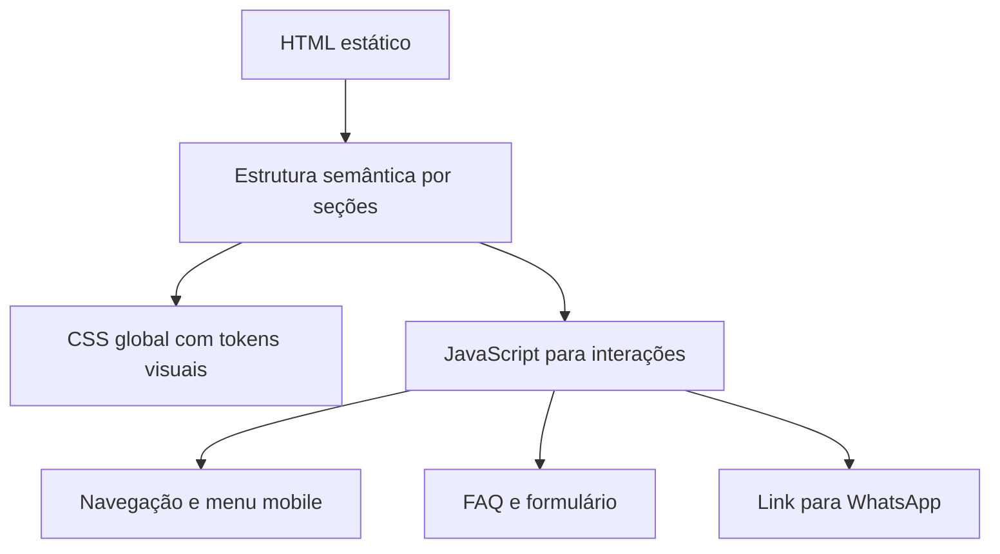
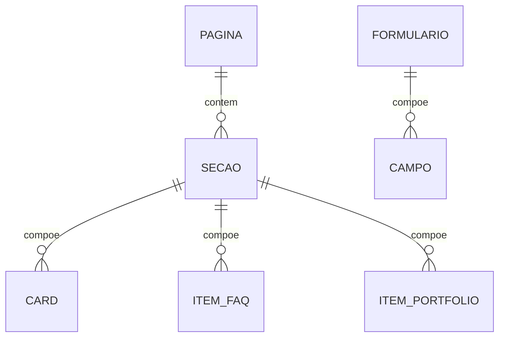

## 1. Desenho da Arquitetura



## 2. Descrição da Tecnologia
- Frontend: HTML5 semântico + CSS3 + JavaScript puro
- Estilização: CSS organizado por tokens, utilidades locais e componentes visuais reutilizáveis
- Interações: JavaScript vanilla para menu mobile, FAQ, rolagem suave e apoio ao formulário
- Gerenciamento de dados: conteúdo escrito diretamente na página, com estrutura pensada para edição simples
- Formulário: submissão inicial por integração simples de contato, podendo usar ação externa configurável
- Hospedagem: preparada para deploy estático

## 3. Definição de Rotas
| Rota | Objetivo |
|---|---|
| / | Exibir a landing page completa da Inovarejo com navegação por âncoras internas. |

## 4. Definições de API
Como a primeira versão pode operar sem backend próprio, a aplicação deve nascer pronta para integração simples:

```js
const leadFormData = {
  nome: "",
  whatsapp: "",
  empresa: "",
  cidadeEstado: "",
  servicos: [],
  maturidadeMarketing: "",
  desafioPrincipal: ""
};
```

Se houver endpoint no futuro, a interface esperada pode ser:

```js
const leadFormResponse = {
  success: true,
  message: ""
};
```

## 5. Modelo de Organização do Frontend
- `index.html`: composição geral da landing page e conteúdo institucional.
- `styles.css`: tokens visuais, layout, responsividade, componentes e estados.
- `script.js`: interações do menu, FAQ, destaque de navegação e apoio ao formulário.
- `assets/`: logos, imagens e arquivos reais da Inovarejo quando disponíveis.

## 6. Modelo de Dados

### 6.1 Definição do Conteúdo Local



### 6.2 Estrutura de Conteúdo
- Métricas institucionais: lista de objetos com número, rótulo e apoio textual.
- Soluções: lista de objetos com nome, descrição e ícone.
- Segmentos: lista curta com segmento e aplicação.
- Estrutura física: lista com título e descrição.
- Depoimentos: lista com tipo, autor, empresa, cidade, segmento e mídia opcional.
- FAQ: lista de pergunta e resposta.
- Portfólio: lista de itens com categoria, título, imagem e descrição curta.

## 7. Decisões Técnicas de Implementação
- A página será construída como landing page estática de rota única, com navegação por âncoras e foco em carregamento rápido.
- A base visual usará variáveis CSS para manter consistência de cor, espaçamento, sombra e raio.
- As interações serão mantidas simples, com JavaScript leve e sem dependências externas obrigatórias.
- As imagens devem aceitar substituição progressiva por ativos reais da Inovarejo sem alterar a estrutura da interface.
- O formulário deve funcionar de modo degradável: se não houver endpoint, o CTA alternativo para WhatsApp continua operacional.
- SEO técnico deve incluir título, descrição, canônica autorreferencial, Open Graph, Twitter Cards e dados estruturados compatíveis com página institucional.
