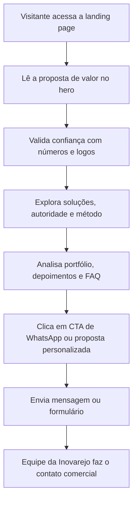

## 1. Visão Geral do Produto
Landing page institucional e comercial da Inovarejo para apresentar sua proposta de valor, comprovar autoridade no mercado e converter visitantes em contatos qualificados via WhatsApp e formulário.
- O produto deve comunicar a Inovarejo como parceira completa de marketing, estratégia e execução, indo além da percepção de "agência de posts".
- O objetivo de negócio é aumentar geração de leads, fortalecer posicionamento e transformar prova social, estrutura e portfólio em conversão comercial.

## 2. Funcionalidades Centrais

### 2.1 Módulos Principais
1. **Landing page principal**: hero, navegação, prova social, soluções, autoridade institucional, método, portfólio, FAQ, CTA final e formulário.
2. **Ações de conversão**: botões para WhatsApp com mensagem automática, formulário simples e atalhos no menu para pontos de contato.

### 2.2 Detalhamento da Página
| Nome da página | Nome do módulo | Descrição da funcionalidade |
|---|---|---|
| Landing page | Menu fixo | Exibir navegação por âncoras para Início, Soluções, Quem Somos, Estrutura, Clientes, Depoimentos, FAQ e Contato, com CTA destacado no topo. |
| Landing page | Hero principal | Comunicar a proposta central da Inovarejo com título forte, subtítulo objetivo, imagem real e CTAs principais. |
| Landing page | Provas rápidas | Mostrar métricas institucionais como tempo de atuação, clientes atendidos, vendas acompanhadas e abrangência geográfica. |
| Landing page | Logos e prova social | Reforçar confiança com logos de marcas, redes e projetos atendidos. |
| Landing page | Soluções integradas | Organizar os serviços em cards escaneáveis, com foco em amplitude e integração entre estratégia e execução. |
| Landing page | Quem somos | Explicar a origem prática no varejo e a visão consultiva da empresa. |
| Landing page | Quem conduz | Apresentar José Lucas com autoridade, vivência prática e cards de credenciais. |
| Landing page | Nosso jeito de trabalhar | Explicar o método IN·A como processo simples, prático e orientado à ação. |
| Landing page | O que entregamos | Traduzir serviços em valor percebido, suporte, organização e acompanhamento. |
| Landing page | Segmentos atendidos | Mostrar atuação em diferentes realidades de negócio sem limitar posicionamento. |
| Landing page | Hub de Marketing | Apresentar a estrutura física da Inovarejo com fotos e cards do espaço. |
| Landing page | Depoimentos | Exibir depoimentos em texto e espaço preparado para vídeos curtos. |
| Landing page | Portfólio em destaque | Mostrar uma seleção curta de campanhas, materiais e experiências reais. |
| Landing page | Caminhos de parceria | Organizar formatos de atuação em linguagem consultiva e comercial. |
| Landing page | FAQ | Quebrar objeções comuns sobre escopo, segmentos, assessoria, materiais e atendimento regional. |
| Landing page | CTA final | Reforçar o convite para contato com botões de alta visibilidade. |
| Landing page | Formulário | Captar nome, WhatsApp, empresa, localidade, necessidade, maturidade de marketing e principal desafio. |
| Landing page | Rodapé | Reforçar marca, localização, redes, WhatsApp e links rápidos. |

## 3. Processo Central
O usuário chega à página, entende rapidamente o posicionamento da Inovarejo, valida confiança por meio de números, logos, estrutura, depoimentos e portfólio, identifica o serviço mais próximo da sua necessidade e converte por WhatsApp ou formulário.

## 4. Design da Interface

### 4.1 Estilo Visual
- Direção visual: premium comercial, limpa, institucional e contemporânea, com sensação de estrutura, confiança e proximidade.
- Cores principais: branco como base, azul `#000cc9` como apoio institucional e laranja `#da762e` como cor de conversão.
- Botões: CTA principal em laranja sólido, CTA secundário em azul ou estilo contornado.
- Tipografia: títulos com personalidade profissional e presença; corpo com leitura limpa e alta escaneabilidade.
- Layout: desktop-first com navegação superior, blocos bem espaçados, cards responsivos, seções com alternância de respiro e impacto.
- Ícones: simples, lineares e objetivos, sem excesso decorativo.
- Imagens: prioridade absoluta para fotos reais da Inovarejo, sede, equipe, bastidores, PDV, campanhas e clientes.

### 4.2 Visão de Design por Módulo
| Nome da página | Nome do módulo | Elementos de UI |
|---|---|---|
| Landing page | Hero principal | Headline de alto contraste, copy enxuta, botões destacados, imagem institucional forte e métricas visíveis. |
| Landing page | Provas rápidas | Cards numéricos com animação sutil de entrada e leitura imediata. |
| Landing page | Logos | Grade limpa ou carrossel suave com logos em tratamento visual discreto. |
| Landing page | Soluções | Grid de cards com ícones, títulos curtos e textos curtos. |
| Landing page | Blocos institucionais | Seções com composição editorial, fotos reais, destaques em cor e frases-chave. |
| Landing page | Método IN·A | Três cards ou etapas com leitura progressiva e linguagem prática. |
| Landing page | Hub e portfólio | Galeria visual com imagens reais, recortes fortes e foco em credibilidade. |
| Landing page | FAQ | Acordeão simples, rápido e legível. |
| Landing page | Conversão | CTA final de alto contraste e formulário compacto de uma coluna no mobile. |

### 4.3 Responsividade
- Abordagem desktop-first, com adaptação completa para tablet e mobile.
- Menu com comportamento responsivo, incluindo navegação compacta em telas menores.
- Cards reorganizados em colunas fluidas.
- Prioridade para legibilidade, toque confortável e manutenção da força visual das provas sociais e CTAs.

### 4.4 Conteúdo Obrigatório
- Mensagem automática de WhatsApp: "Olá, Inovarejo! Vim pelo site e gostaria de entender como vocês podem ajudar minha empresa com marketing, campanhas e comunicação."
- Frases-chave reaproveitáveis: "Marketing, estratégia e execução integradas em um só lugar.", "Do digital ao PDV, sua marca mais presente.", "A gente conhece o varejo de perto.", "O próximo passo é seu."
- Materiais esperados para versão final: logo oficial, fotos reais, logos de clientes, depoimentos, portfólio, WhatsApp oficial, endereço e links de redes sociais.
